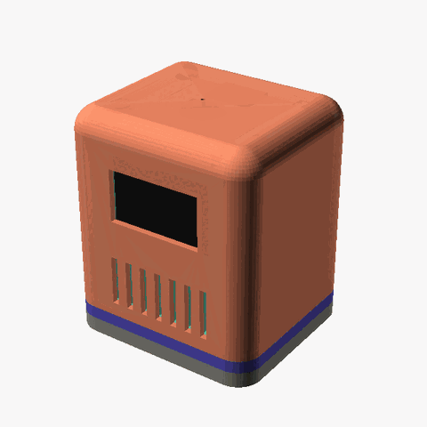
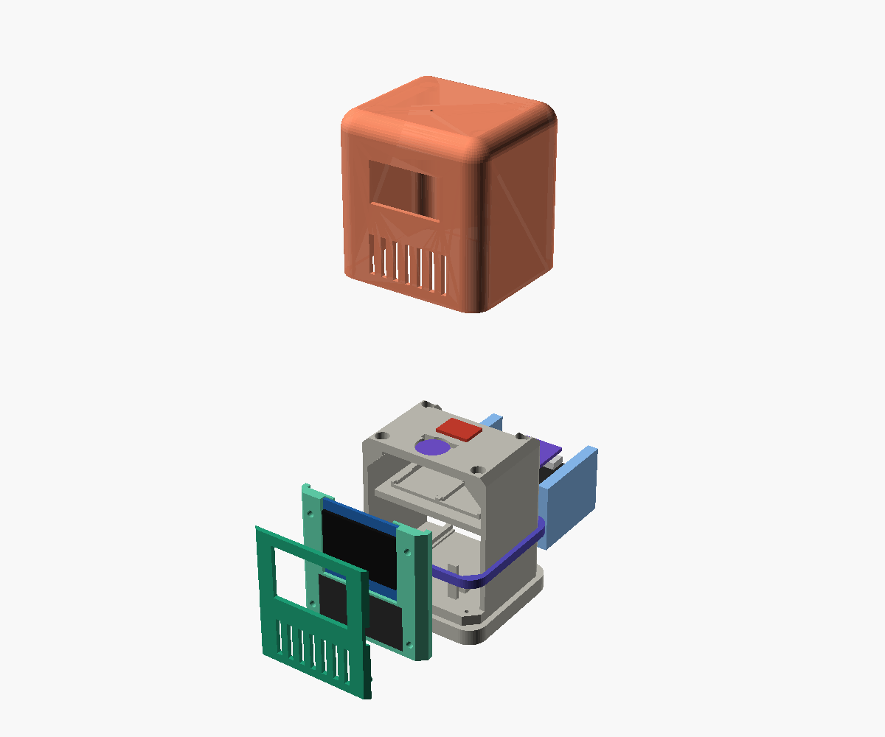

# Sparky

**A modular, magnetic ESP32-C3 desk buddy.** Sparky has an animated OLED face, listens through a microphone, talks through a speaker, reacts to touch and to being shaken or picked up, and runs on USB or its own battery. Every board slides into its own groove and plugs together with Dupont wires: no screws, no soldered wiring. Wire it outside, slide everything in, and the magnetic shell holds it all together.

<p align="center"></p>

[](https://github.com/slahiri/sparky/actions/workflows/cad.yml)
[](https://github.com/slahiri/sparky/actions/workflows/firmware.yml)
[](https://github.com/slahiri/sparky/releases/latest)
[](LICENSE.md)
[](LICENSE.md)

> **Status: early prototype (v0.2).** The CAD is parametric and checked for overlaps and overhangs, but part sizes are estimates and the v0.2 parts have not been test-printed yet. Measure your parts and adjust [`cad/config.scad`](cad/config.scad) before printing.

## Features

- 1.3" OLED face with animated eyes, speaker right below it
- I²S microphone (INMP441) and speaker (MAX98357A + 4 Ω speaker)
- Capacitive touch on the head, shake / tilt / tap sensing (MPU-6050)
- USB-C power, optional LiPo slid in along a side wall
- Only the shell comes off: everything else slides in from the back or the front
- Slide-in, solderless electronics: wire it outside, slide it in
- Every part prints without supports
- Fully parametric OpenSCAD source

## The modules



| Module | What it does |
|---|---|
| **Outer shell** | Rounded 64.4 × 56.6 mm skin with the display window, speaker grille, USB-C hole and mic pinhole. Snaps to the rack towers with 4 magnets and holds every inner part in place. |
| **Interface collar** | The accent band between the rack's bottom and the shell. Located by filament pins, clamped by the shell. |
| **Rack** | The body, one print: a solid bottom Sparky stands on, side walls, floor rails for the ESP32 board, a fixed middle plate with grooves for the MPU-6050 and the amp, and a fixed top that holds the mic and touch pad over openings. The plate and top stop 6 mm short of the open back: that gap is the wire channel. |
| **Face frame** | The front: the display slides into its groove and the speaker sits in its pocket below. Stands on two pins in the rack floor. |
| **Front plate** | The display window and speaker grille. Presses onto the face frame with 4 round pegs; notches on both sides let you pull it off to reach the display and speaker. |

## Repository layout

```
sparky/
├── cad/                 OpenSCAD source (edit config.scad first)
│   ├── config.scad      all dimensions + the module interface spec
│   ├── sparky.scad      assembly and part selector
│   └── parts/           shell, collar, rack, face, front
├── .github/workflows/   CI: builds STLs, renders and firmware; publishes releases
├── firmware/            PlatformIO project for the ESP32-C3
├── hardware/            BOM, wiring diagram, pin map
├── docs/                build guide
└── scripts/             STL export, renders, fit and overhang checks
```

## Build it

1. **Collect the parts:** [hardware/bom.csv](hardware/bom.csv)
2. **Print:** download the STLs from the [latest release](https://github.com/slahiri/sparky/releases/latest), then follow [docs/printing.md](docs/printing.md)
3. **Wire:** [hardware/wiring.md](hardware/wiring.md)
4. **Assemble:** [docs/assembly.md](docs/assembly.md)
5. **Flash the test firmware:** [docs/firmware.md](docs/firmware.md)

Full guide: [docs/](docs/index.md)

## Customise

Everything is driven by [`cad/config.scad`](cad/config.scad). To make your own shell, keep the interface in [docs/interface.md](docs/interface.md) and change only the outside.

STLs are **built from the OpenSCAD source by CI**, never committed:

- Every push and pull request builds all STLs and preview renders; download them from the run's artifacts.
- Pushing a tag like `v0.2.0` publishes a [release](https://github.com/slahiri/sparky/releases) with the STLs, renders and firmware.
- To build locally (OpenSCAD 2021.01 or newer):

```bash
./scripts/export_stl.sh      # STLs into stl/
./scripts/check_fit.sh       # no overlaps, every part on the bed
./scripts/render_png.sh      # preview images into renders/
./scripts/render_gif.sh      # the explode animation (needs ImageMagick)
```

## Inspiration

Sparky stands on the shoulders of other open desk companions, especially [Compagnon 309 by Leroyd](https://makerworld.com/en/models/2109424), [The Mochi housing by Dave0616](https://makerworld.com/en/models/1844353) and [QBIT by SeanChangX](https://github.com/SeanChangX/QBIT). No files from those projects are included here.

## License

- Hardware (CAD, STL, docs, diagrams): [CC BY-SA 4.0](https://creativecommons.org/licenses/by-sa/4.0/)
- Firmware and scripts: [MIT](LICENSE.md)

See [LICENSE.md](LICENSE.md). Contributions welcome: see [CONTRIBUTING.md](CONTRIBUTING.md) and the [Code of Conduct](CODE_OF_CONDUCT.md).
