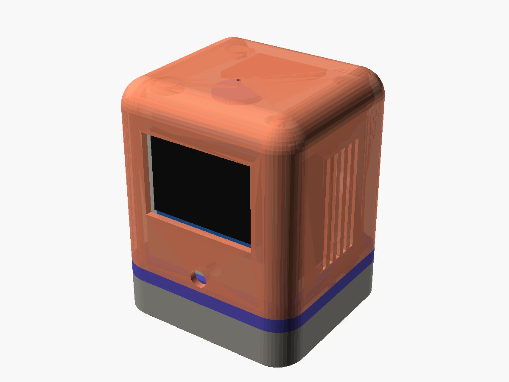

# Sparky

**A modular, magnetic ESP32-C3 desk buddy.** Sparky has an animated OLED face, listens through a microphone, talks through a speaker, reacts to touch and knocks, and runs on USB or its own battery. Every module snaps together with magnets, so you can swap the shell, the battery base or the electronics rack without tools.



[](https://github.com/slahiri/sparky/actions/workflows/cad.yml)
[](https://github.com/slahiri/sparky/actions/workflows/firmware.yml)
[](https://github.com/slahiri/sparky/releases/latest)
[](LICENSE.md)
[](LICENSE.md)

> **Status: early prototype (v0.1).** The CAD is a first parametric draft built from estimated part sizes and has not been test-printed yet. Measure your parts and adjust [`cad/config.scad`](cad/config.scad) before printing.

## Features

- 1.3" OLED face with animated eyes
- I²S microphone (INMP441) and speaker (MAX98357A + 4 Ω speaker)
- Capacitive touch on the head, knock detection, status LED
- USB-C power, optional LiPo battery in a magnetic base
- Four modules that snap together with 6 × 3 mm magnets
- Fully parametric OpenSCAD source

## The modules


| Module | What it does |
|---|---|
| **Outer shell** | Rounded 56 × 52 mm skin with the screen window, mic pinhole, LED hole, speaker grille, USB and switch cutouts. Snaps to the rack crown with 4 magnets. |
| **Interface collar** | The separate lip between base and shell. Located by filament pins, clamped by the shell. Print it in an accent colour. |
| **Inner rack** | Reinforced PLA frame (3 mm walls, gussets) that carries every electronic part. |
| **Crown** | The rack's removable top. Slides in from the back on dovetail rails and carries the mic, touch sensor and shell magnets. Slide it out and the whole rack is open from above for wiring. |
| **Battery base + lid** | Holds a 503040 LiPo. Snaps to the rack with 4 magnets; the lid snaps on with 4 more. |

## Repository layout

```
sparky/
├── cad/                 OpenSCAD source (edit config.scad first)
│   ├── config.scad      all dimensions + the module interface spec
│   ├── sparky.scad      assembly and part selector
│   └── parts/           shell, collar, rack, crown, base, lid
├── .github/workflows/   CI: builds STLs, renders and firmware; publishes releases
├── firmware/            PlatformIO project for the ESP32-C3
├── hardware/            BOM, wiring diagram, pin map
├── docs/                build guide
└── scripts/             helper scripts (STL export)
```

## Build it

1. **Collect the parts:** [hardware/bom.csv](hardware/bom.csv)
2. **Print:** download the STLs from the [latest release](https://github.com/slahiri/sparky/releases/latest), then follow [docs/printing.md](docs/printing.md)
3. **Wire:** [hardware/wiring.md](hardware/wiring.md)
4. **Assemble:** [docs/assembly.md](docs/assembly.md)
5. **Flash the test firmware:** [docs/firmware.md](docs/firmware.md)

Full guide: [docs/](docs/index.md)

## Customise

Everything is driven by [`cad/config.scad`](cad/config.scad). To make your own shell, keep the interface in [docs/interface.md](docs/interface.md) and change only the outside.

STLs are **built from the OpenSCAD source by CI**, never committed:

- Every push and pull request builds all STLs and preview renders; download them from the run's artifacts.
- Pushing a tag like `v0.2.0` publishes a [release](https://github.com/slahiri/sparky/releases) with the STLs, renders and firmware.
- To build locally (OpenSCAD 2021.01 or newer):

```bash
./scripts/export_stl.sh      # STLs into stl/
./scripts/render_png.sh      # preview images into renders/
```

## Inspiration

Sparky stands on the shoulders of other open desk companions, especially [Compagnon 309 by Leroyd](https://makerworld.com/en/models/2109424), [The Mochi housing by Dave0616](https://makerworld.com/en/models/1844353) and [QBIT by SeanChangX](https://github.com/SeanChangX/QBIT). No files from those projects are included here.

## License

- Hardware (CAD, STL, docs, diagrams): [CC BY-SA 4.0](https://creativecommons.org/licenses/by-sa/4.0/)
- Firmware and scripts: [MIT](LICENSE.md)

See [LICENSE.md](LICENSE.md). Contributions welcome: see [CONTRIBUTING.md](CONTRIBUTING.md) and the [Code of Conduct](CODE_OF_CONDUCT.md).
