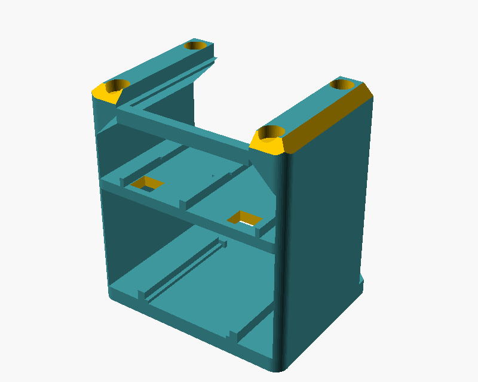

# Printing

STLs are in [stl/](https://github.com/slahiri/sparky/tree/main/stl). They're already placed in their print orientation.

| Part | File | Orientation | Notes |
|---|---|---|---|
| Outer shell | `sparky_shell.stl` | Open side down | The ceiling is a ~48 mm bridge; enable bridge cooling, or add tree supports inside |
| Interface collar | `sparky_collar.stl` | Flat | Accent colour looks great |
| Inner rack | `sparky_rack.stl` | Upright on its floor | Structural: see settings below |
| Battery base | `sparky_base.stl` | Deck down | No supports needed |
| Battery lid | `sparky_lid.stl` | Flat | |

## Recommended PLA settings

| Setting | Shell, collar, base, lid | Inner rack |
|---|---|---|
| Layer height | 0.2 mm | 0.2 mm |
| Walls | 3 | 5 |
| Infill | 15 % gyroid | 30 % gyroid |
| Supports | none (see shell note) | none |

The rack's 3 mm walls with 5 perimeters print almost solid, which is what keeps it from cracking. Keep PLA parts out of hot cars and direct sun: PLA softens around 55 °C.

## Before the full print

Print a test of one magnet pocket (6.2 × 3.2 mm) and one M2 pilot hole. If the magnet is loose, lower `mag_d` in [config.scad](https://github.com/slahiri/sparky/blob/main/cad/config.scad); if it won't go in, raise it. Then regenerate the STLs with `scripts/export_stl.sh`.
