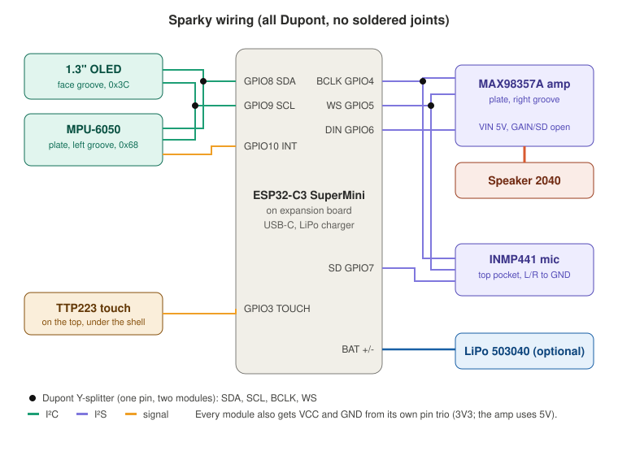

# Wiring

Everything plugs together with female–female Dupont jumpers: no soldered joints between modules. The expansion board brings each GPIO out as a pin trio: **S** (signal), **V** (power) and **G** (ground). Wire the modules outside Sparky first, then slide them in.

| Module | Module pin | Expansion board |
|---|---|---|
| 1.3" OLED | SDA / SCL | GPIO 8 S / GPIO 9 S (through Y-splitters) |
| 1.3" OLED | VCC / GND | GPIO 8 V / GPIO 8 G |
| MPU-6050 | SDA / SCL | GPIO 8 S / GPIO 9 S (through the same Y-splitters) |
| MPU-6050 | INT / VCC / GND | GPIO 10 S / GPIO 1 V / GPIO 1 G |
| MAX98357A | BCLK / LRC / DIN | GPIO 4 S / GPIO 5 S (Y-splitters) / GPIO 6 S |
| MAX98357A | VIN / GND | 5V / GND |
| INMP441 | SCK / WS / SD | GPIO 4 S / GPIO 5 S (same Y-splitters) / GPIO 7 S |
| INMP441 | VDD / GND / L/R | GPIO 7 V / GPIO 7 G / GPIO 2 G |
| TTP223 | OUT / VCC / GND | GPIO 3 S / GPIO 3 V / GPIO 3 G |
| Speaker | + / − | amp screw terminal |
| LiPo 503040 (optional) | 2-pin plug | expansion board battery connector |

Notes:

- Four lines are shared, so you need **4 Dupont Y-splitters**: SDA and SCL (OLED + MPU-6050), BCLK and WS (amp + mic).
- The INMP441's **L/R pin must go to ground** or the mic sends nothing. Any free G pin works.
- Never put 5 V on the INMP441 or the MPU-6050; use the V pins (3.3 V). Check your board's V pins really are 3.3 V.
- Leave the MAX98357A `SD` and `GAIN` pins unconnected (always on, 9 dB).
- Screw the speaker wires into the amp's terminal **before** you slide the middle plate in: the terminal faces down and you can't reach it afterwards.
- Free pins: GPIO 0, 1, 20, 21. Don't load GPIO 2's signal pin (boot strap); its ground pin is fine.
- The pin map lives in [`firmware/include/pins.h`](../firmware/include/pins.h).
